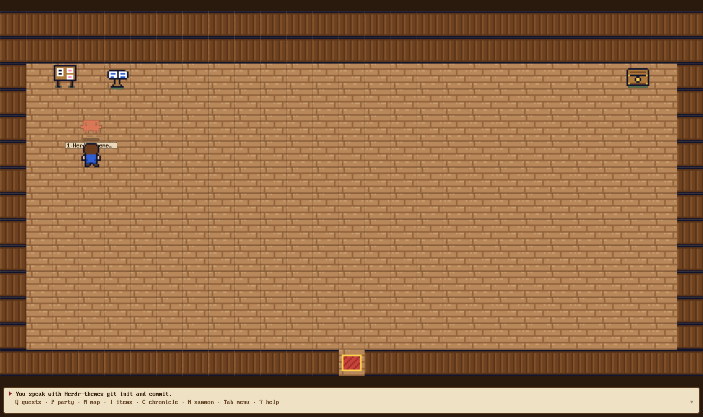

# Herdr Quest

Herdr turned into a 16-bit RPG. The window opens on a walkable pixel village.
Every space is a house, and each agent is a hero who lives inside the house of
its space. Walk the hero up to a house to see what's going on inside: smoke
while agents work, a bouncing ‼ when one needs you. Go in, face an agent and
press Space, and its live terminal opens in a conversation window. Cmd-E flips
to the **Workshop**, where the terminals are: tabs are quests on a parchment
quest bar, and panes are workbench windows. Everything is drawn in brown ink
on parchment, in the PxPlus IBM VGA 8x16 pixel font.



## What you see

**Window.** No title bar (`"titlebar": "none"`). The macOS traffic lights sit
at `[14, 18]`. The root background is a vertical gradient from `#2a1c10` to
`#140d07`. All mod text is PxPlus IBM VGA 8x16 at exactly 16px with a 16px
line height: one character is 8px wide, and glyphs come from code page 437
(`► ♦ ☼ ‼ ⌂ ▲ ♣ ≈ ░ ▒ ▓ █ ☺ §`). The layout sets `ui_font` to that font and
`terminal_padding` to `[10, 8]`. It doesn't set a terminal font.

A stack (`stage`) shows one of two views. It starts on the village.

### The village (`field`)

The village fills the window (block background `#26392a`, or `#2a1a0e` inside a
house). It's a tile grid centred in the space above the dialogue box. The tile
size S is the largest of 64, 48 and 32 px that still fits at least 18 columns
by 11 rows. Columns are `floor(width / S)` (at least 12) and rows are
`floor(height / S)` (at least 9). The art is 16×16 pixel art, scaled to S with
`crispEdges`. Ground tiles are drawn S+1 wide so no seams show. The map's own
background is `#5f8a62` (`#b8875a` inside a house).

**Outside.**
- **Border:** trees all the way round.
- **Ground:** grass in two variants, with a flower tile wherever
  `noise(x,y) % 11 == 0`. Noise is `((x*73856093) ^ (y*19349663)) >>> 0`, so
  the village looks the same every time.
- **Houses:** one 2×2-tile house per space (32×32 art: red roof, chimney,
  cream walls, door, lit window), laid out in bands of 5 rows. House `i` sits
  at `x = 2 + (i % per) * 6`, `y = 1 + band * 5`, where
  `per = floor((cols - 2) / 6)` and `bands = floor((rows - 6) / 5)`.
- **Roads:** each used band has a dirt road across the full width at
  `y + 2`. A road runs from the last road down the middle column
  (`spawnX = floor(cols / 2)`) to the bottom edge.
- **Plaza:** at `y = max(lastRoad + 2, rows - 3)`, at these offsets from
  `spawnX`:
  - lectern −6
  - quest board −4
  - signpost −2 (one row lower)
  - chest +2
  - well +4
  - campfire +6. The fire flickers by fading a second frame in and out
    every 500ms.
- **Pond:** if the grid is at least 20×10, a 5×3 pond fills the bottom-right
  corner (water tiles alternating by `(x+y)%2`). Its top-left tile is left as
  grass.
- **Hero spawn:** `(spawnX, rows - 2)`.
- **Overflow:** spaces that don't fit aren't drawn. The narrator says
  "N more beyond the hills."

**What a house shows outside**, based on its space's status (only when agents
live there):

| State | Signs |
| --- | --- |
| working | Three smoke puffs (`#f4efe6`) rise from the chimney and fade, every 1500, 1850 and 2200ms. The window glows `#ffcf5a` (opacity 0.1→0.75, every 1100ms). |
| blocked | The window glows `#ff5a3c` every 500ms. A `‼` chip (parchment, 2px vermilion border) bounces 8px over the roof every 450ms. |
| done | No signs beyond the plaque. |
| idle | No signs beyond the plaque. |

**House plaque.** To the right of each house, at
`(x*S + 2S + 4, y*S + S + S/2 − 9)`, is a plaque: 18px tall, background
`#efe2c4ee`, 1px border (walnut, or vermilion when blocked). It shows:
- `►Name` in oxblood for the shown space, `⌂Name` otherwise
- the state:
  - `in progress·`, `··` and `···` in moss, cycling every 400ms
  - `‼ needs you` in vermilion, fading in and out every 700ms
  - `☼ done!` in gold leaf
  - `z resting` in dim
- `☺n`, the number of agents who live there

**Inside a house.**
- **Room:** plank floor, with two rows of timber wall at the top and one row
  on the sides and bottom. The door is a red-and-gold mat at the bottom
  centre.
- **Back wall** (row 2): the house's quest board at x=2, lectern at x=4, and
  chest at `cols − 3`.
- **Agents:** they stand on a grid at x = 3, 6, 9, … ≤ `cols − 4` and
  y = 4, 7, … ≤ `rows − 4`. Extras are counted: "N more upstairs."
- **How an agent looks:**
  - Its program's icon, 13/16 of S, on a soft shadow ellipse (`#0000004d`).
    Icons with `tint` are drawn in the program's `tile` or `color`.
  - With no icon, it's a robed NPC sprite. The robe color comes from the
    program: claude orange, codex teal, gemini blue, cursor purple, opencode
    green, pi red. Any other program gets a color from a hash of its address.
  - Under it hangs a name plate `tabIndex·name` (parchment `#efe2c4e6`, 1px
    walnut border, at most 2S wide).
- **How an agent moves:**
  - working: small hops of S/8 every 420ms
  - done: big victory jumps of S/3.5 every 900ms
  - blocked: shakes ±S/24 every 160ms, with a `‼` bubble above it
  - idle: stands still

**The hero.** A 16px figure with brown hair, a blue tunic and a gold belt. It
has 4 facings × 3 frames (stand, left stride, right stride). It glides between
tiles in a linear 120ms move and bobs up S/16 on stride frames.

**The dialogue box.** Fixed at the bottom of the village:
- **Box:** 66px tall, 8px margin, 12×8 padding, radius 6, parchment
  `#efe2c4`, 2px walnut border.
- **Line 1:** `►`, then a title (colored by state when it describes an
  agent or house), then a hint on the right in oxblood.
- **Line 2** (indented 16px): muted text, usually the legend
  `Q quests · P party · M map · I items · C chronicle · N summon · Tab menu · ? help`.
  At the right end is a walnut `▼` that blinks while the village has the
  keyboard. Otherwise it shows `Click the field to take control` in
  vermilion, flashing.
- **Titles:**

  | Situation | Title |
  | --- | --- |
  | Facing an agent | `Name · Program · quest N`, with its line in quotes |
  | Facing a house | `The house of X.` / `n heroes live here · status · n quests` |
  | Facing an object | Its own text (see How it behaves) |
  | Inside a house | `Inside X: n heroes.` |
  | Outside, an agent is blocked | `‼ Name awaits your orders in Space!` (vermilion) |
  | Outside, otherwise | `n heroes live in n houses.` |

  Agent lines by status:
  - blocked: `‼ I await your orders, commander!`
  - working: `Hard at work on your quest. Come and watch?`
  - done: `☼ My task is done! Come and see what I've made.`
  - idle: `Zzz... ready for a new quest.`

### The workshop (`main`)

The workshop is a column with two parts.

**The quest bar.** A 48px block at the top, with a parchment gradient
`#f3e8cf` → `#ddc89c`, a 3px `#5a3a1e` border, and `window_drag`. Left to
right:
- **Left padding:** on macOS with no title bar, `(traffic_lights[0] + 64) / zoom`
  (at least 12) so the traffic lights fit; otherwise 12.
- **The crest:** `♦ HERDR QUEST ♦`, with bold walnut text between oxblood
  diamonds. It opens the world menu.
- **A divider:** 2×24px.
- **`Space name:`** in dim, at most 180px.
- **The tabs**, as a horizontal scrolling row of quests:
  - Each quest is a 30px chip with radius 6. It shows the program icon
    (14px), `index·name` (at most 200px), a cyan `■` if zoomed, `z` if
    settled, and a status glyph.
  - The active quest has a 2px walnut border, background `#dcc595`, oxblood
    text, a blinking `►` and an `x` (close tab).
  - Settled tabs are dim.
- **Runes:** `► Explore`, `+ Quest`, and `≡ Menu` (shown as `■ Menu` while
  the command window is open).
- **Window buttons:** `_ ■ X` appear only when the window has its own
  buttons (not macOS).

**The tab view.** Below the bar is a row with 8px padding and background
`#1f150c`, holding the active tab's panes:
- gap 8, radius 8
- pane background is the theme background
- 2px `#7a5530` border, and 2px `#d9a441` when focused
- `lone: true`
- a 30px header at the top, always shown

**Pane header.**
- **Background:** parchment `#efe2c4` when focused, `#e3d2ac` otherwise, with
  a 1px rule at the bottom.
- **Left:** a blinking `►` when focused, the program icon, and the name
  (oxblood when focused), then `@ ~/folder` in dim.
- **Status chip:** when the pane isn't idle, a chip on `#dcc595` with the
  glyph and the status word.
- **`▲hist`:** shown while the pane is scrolled back; it jumps to the
  bottom.
- **Runes:** `→` and `↓` (split), `■`/`▬` (zoom), `x` (close).

### Windows and popups

**Panel windows** are Herdr overlay windows with keys `hq-panel-<name>`, drawn
on parchment (`#f3e8cf` → `#e2cfa6`). Each starts with `♦ TITLE` in oxblood,
runes on the right including `x`, and a 2px rule.

| Panel | Key | Size | Contents |
| --- | --- | --- | --- |
| QUEST LOG | Q | 440×470 | Every space's tabs, shown space first. Each space header shows `⌂`/`≡`, its name and `§ branch`. Each row shows the icon, `index·name`, `z`, `n■` (pane count) and a glyph. Rune `+Quest`. |
| PARTY | P | 380×520 | Hero cards in party order. Line 1: icon, name, `♥` if pinned, glyph. Line 2: `Program · Space·tab`. Line 3: a 64×6 gauge, the status word, and time at work (`<1m`, `12m`, `1h05`, `2d`). Sub-agents are listed under their hero as `└♣ name`. Runes `◄ ► +Hero`. Blocked cards get a 1px vermilion border. When empty: `► Summon a hero`. |
| WORLD MAP | M | 360×470 | Spaces grouped by machine (`≡ Home land`, `≡ name`, `(lost)`). Each space shows a terrain glyph picked from a hash of its id (`⌂ ▲ ♣ ≈ Ω π ∩ Σ ♠ Φ`, cyan), its name and glyph, then `§ branch` (or `· wilds`) and `n quests`. Runes `+Realm +Land`. |
| COMMAND | Tab | 540×182 | A 5-column grid of 16 commands: Village, Workshop, Forge (new tab), Summon, Split →, Split ↓, Quests, Party, Map, Inventory, Chronicle, Scout (finder), Spellbook (palette), Lore (help), Camp (settings), Warp (world menu). Open panels are gold with a `•`. Each tooltip names the real action and its key. |
| INVENTORY | I | 440×600 | A 34px title bar (`#e8d6ae` → `#d6bf8e`) reading `♦ INVENTORY [I] x`, over the shipped `files` mod on `surface`. |
| CHRONICLE | C | 500×600 | The same, over the shipped `changes` mod. |

**Conversation window.** A 780×470 overlay window with key
`hq-talk-<address>`:
- **Title bar** (34px, same gradient): `► Speaking with`, then
  `Name · Space·tab`, then the status chip, `To workshop` and `x`.
- **Body:** the agent's live terminal, on the theme background.

**Menus.** Popups with `frame: "none"`:
- **Size:** 260–300px wide, `min(560, 48 + rows*24)` tall.
- **Look:** parchment, radius 8, 2px walnut border, 8px padding.
- **Rows:** headings are 20px `♦ HEADING` in oxblood. Items are 24px, each
  with a `►` cursor, an icon, the label, and a dim note or hint on the right.
  Separators are 2px rules.
- **Colors:** disabled items are dim. Dangerous items are `#a8453a`, and
  vermilion under the cursor.

| Kind | Items |
| --- | --- |
| summon | NEW QUEST: Lone adventurer (a terminal). SUMMON A HERO: each installed agent from `knownAgents()`, numbered 1–9; up to two missing ones, greyed with "not found". Then Discover new realm, Forge worktree…, Enter worktree… |
| realm | Travel here, New quest here, Rename realm, worktree items (only in a git checkout; "Unmake worktree…" only in a linked worktree), Move up, Move down, Abandon realm |
| quest | Rename quest, New quest, Move left, Move right, Rest at / Wake from the inn (settle), Abandon quest |
| pane | WORKBENCH: Split right, Split down, Zoom, Return to parent (sub-agents), Close pane |
| member | Give orders (focus), Scry (peek), Lead / Leave the vanguard (pin) |
| world | Warp to each other layout, Chart new land (add machine), Camp, Lore, Tales of new |

**Toasts.** Every Herdr notification is drawn by this mod:
- **Box:** parchment, 2px walnut border.
- **Icon:** the notification's icon, or a `►` colored by level: error
  vermilion, warning gold leaf, success moss, info verdigris.
- **Text:** the title in that color, the body in ink, and a blinking `▼`.

### Palette

| Name | Hex | Use |
| --- | --- | --- |
| ink | `#3b2614` | Text |
| muted | `#6b4a2b` | Secondary text |
| dim | `#8f7350` | Faint text |
| oxblood | `#8b1e1e` | Headings, cursor, the chosen item |
| gold leaf | `#a8740f` | done |
| vermilion | `#c8321f` | blocked |
| moss | `#3f6e27` | working |
| verdigris | `#2e6a6a` | Branches, terrain |
| walnut | `#5a3a1e` | Frames |
| rule | `#5a3a1e55` | Rules |
| parchment | `#efe2c4` | Windows |
| deep parchment | `#e3d2ac` | Unfocused pane headers |
| hover | `#5a3a1e1f` | Hover |
| select | `#dcc595` | Selected background |
| leather | `#2a1a0e` | Gauge tracks |

The terminal theme `themes/herdr-quest.json` is a dark leather scheme:

| Key | Value |
| --- | --- |
| background | `#1a120b` |
| foreground | `#eadcc0` |
| selection | `#5a3a1e` |
| cursor | `#d9a441` |
| ANSI 0–7 | `#3a2a1c #c8553d #8aa04a #d9a441 #6f8fb0 #b0708f #6aa898 #e0d2b4` |
| ANSI 8–15 | `#76604a #e07a5f #a8c068 #f0c46a #93acc8 #c890ac #8cc4b0 #f8efdc` |

Its panel `colors`:

| Key | Value |
| --- | --- |
| canvas | `#140d07` |
| chrome, surface, popover | `#2a1c10` |
| raised | `#3a2818` |
| hover | `#f5e6c812` |
| selected | `#4a321c` |
| border | `#6b4a2b` |
| input | `#9a7a50` |
| foreground | `#eadcc0` |
| muted | `#c4ad88` |
| dim | `#9a8262` |
| accent / solid | `#d9a441`, on `#1a120b` |
| working | `#8aa04a` |
| blocked | `#e05a3f` |
| done | `#e0b04a` |
| idle | `#9a8262` |

## How it behaves

**Agent status.** Everywhere a status shows, it uses the same word, color and
glyph:

| Status | Word | Color | Glyph | Gauge |
| --- | --- | --- | --- | --- |
| working | At work | moss | `░▒▓█▓▒`, cycling every 120ms | Fill sweeps 6→w px every 1600ms |
| blocked | Awaiting orders! | vermilion | `‼`, opacity 0.2→1 every 700ms | Full, fading 0.35→1 every 700ms |
| done | Victory! | gold leaf | `☼` | Full |
| idle | Resting | dim | none | A third full |

**Party order.** Agents are sorted pinned first, then blocked > done >
working > idle, then by `seq`. The village and the Party panel both call
`setAgentOrder` with this order, so `agent.next` / `agent.prev` follow it. The
Dock badge shows the number of blocked agents, or nothing when there are none.

**Village keys** (only while the village has the keyboard; click it to take
control; ignored when ctrl, cmd or alt is held):

| Key | What it does |
| --- | --- |
| arrows / WASD / hjkl | Walk. Holding a key walks continuously: each tile takes two 60ms ticks (a stride frame, then the stand frame mid-glide), and the system's key repeat is ignored. The most recently pressed held direction wins. Blocked tiles turn the hero without moving. |
| Space / Enter / Z | Act on the tile in front of the hero. |
| Q, P, M, I, C | Toggle the Quest log, Party, World map, Inventory or Chronicle window. |
| Tab | Toggle the Command window. |
| N | Open the summon menu. |
| G | Open the command palette. |
| F | Open the finder (`picker`). |
| O | Open settings. |
| ? | Open help. |
| B | Go to the workshop. |

**Acting on things:**

| Thing | What happens |
| --- | --- |
| House | Enter it: `space.select` that space (unless it's already shown), place the hero just inside the door facing up, and say "You enter the house of X." |
| Agent | Open its conversation window, `pane.focus` its terminal, and say "You speak with X." |
| Mat (door) | Leave the house. |
| Quest board | Quest log |
| Lectern | Chronicle |
| Chest | Inventory |
| Campfire | Party |
| Well | Summon menu |
| Signpost | Command palette |

Clicking a house, agent or object does the same as acting on it. Walking onto
the door tile also leaves the house: the hero reappears in front of the house,
facing down.

**Layout keys** (`keys.json` section `layout:herdr-quest`):

| Key | Command | What it does |
| --- | --- | --- |
| cmd-e | `herdr-quest.explore` | Switch between village and workshop. |
| escape | `herdr-quest.escape` | See Esc order below. |
| cmd-p | `herdr-quest.picker` | Open the finder. |
| cmd-shift-p | `herdr-quest.palette` | Open the command palette. |

Commands reach only the copies of the mod that are on screen. In the village
the field answers them; in the workshop the quest bar does.

**Esc order:**
1. If a Herdr Quest menu is open, close it.
2. Else, if a conversation window's terminal has the keyboard, close that
   conversation.
3. Else, in the village: close the last conversation window opened, else the
   last panel opened, else leave the house. Then take the keyboard back.
4. Else, in the workshop: send a real Esc to the focused terminal
   (`hc keys <terminal> esc`), so agents and editors still get it.

**Clicks in the workshop:**

| Where | Click | Double-click | Right-click | Other |
| --- | --- | --- | --- | --- |
| Quest (tab chip) | Select it | Rename | Quest menu | The mouse wheel over the bar steps through tabs (trackpad deltas build up to 40 before stepping, at most one step per 120ms) |
| Pane header | Focus | Zoom | Pane menu | |
| Party card | Go to the workshop and focus the agent | | Member menu | Clicking a sub-agent peeks at it |
| World map space | Travel there | Rename | Space menu | |
| Quest log row | Go to that space and tab, then the workshop | | Quest menu | |

Presses on controls inside `window_drag` areas stop propagation, so they
don't start a window drag.

**Conversation window.** `To workshop` closes the window, shows the workshop
and runs `agent.focus` on that agent. `x` closes the window; the agent keeps
running. Reopening a conversation with the same agent replaces its window
(same overlay key).

**Toasts.** Clicking a toast runs its action, if it has one, and closes it.

**Saved state.** The hero's position, facing, current house and its spot
outside are saved in the mod's `localStorage` under the key `hero`. They're
restored on start. If the saved house's space has gone, the hero returns
outside. If the saved tile is now blocked or off the grid, the hero is
respawned.

## Built from

**Layout** (`layouts/herdr-quest.json`):

```
root column (titlebar none, theme herdr-quest, ui_font PxPlus IBM VGA 8x16, toast herdr-quest, preview layouts/herdr-quest.svg)
└ stage stack (active field)
  ├ field block (window_drag, #26392a) ← mod herdr-quest {role: field}
  └ main column
    ├ quests block (48px, window_drag, parchment gradient, 3px #5a3a1e border) ← {role: quests}
    └ battle-body row (padding 8, #1f150c)
      └ tabview block: tab active, pane {gap 8, radius 8, background "background", lone,
                        border 2 #7a5530, focus 2 #d9a441, header 30px top always ← {role: pane}}
```

**Mod `herdr-quest`.** `mod.json` is `{"place": "none"}`. A single mod
renders every part. `main.js` picks a class by `props.role`. A copy with
`title` and `overlay` but no role is a toast. Each role is one file:

| Role | File | Draws |
| --- | --- | --- |
| field | `field.js` | The village |
| quests | `quests.js` | The quest bar |
| pane | `pane.js` | Pane headers |
| journal | `journal.js` | Quest log |
| party | `party.js` | Party |
| map | `map.js` | World map |
| command | `command.js` | Command window |
| wintitle | `wintitle.js` | Title bars over shipped panels |
| talk | `talk.js` | Conversation title bar |
| menu | `menu.js` | Every popup menu |
| toast | `toast.js` | Toasts |

`kit.js` holds the palette, `root()` (font, size and ink), the status table,
glyphs and gauges, the `rune` buttons, `openMenu`, `togglePanel`, `escapeKey`,
`syncParty`, and stage switching. `main.js` also registers open panel
windows in `shared("hq.panels")`.

**Shared state:**
- `hq.panels`: panel name → overlay id
- `hq.talks`: terminal → overlay id
- `hq.menu`: the open menu's overlay id
- `new-menu.agents`: a cache of the `knownAgents()` result, shared with the
  shipped `+` menu

**Shipped mods used:**
- `files` and `changes`, inside the Inventory and Chronicle windows
- `picker`, via `mod.open`
- `worktree`, as a dialog for new, open and remove
- `machine-add`, via `mod.open`

**`herdr` functions:** `agents`, `spaces`, `panes`, `terminals`, `machines`,
`layouts`, `layout`, `settings`, `keys`, `focused`, `home`, `updates`,
`window`, `props`, `shared`/`setShared`, `openOverlay`/`closeOverlay`,
`nextCommand`, `setAgentOrder`, `setBadge`, `knownAgents`, `exec`, `hc`, `run`,
`checking`.

**Commands run:**

| Area | Commands |
| --- | --- |
| Stage | `layout.select {stack: "stage", child}` |
| Tabs | `tab.select / new / rename / close / move / settle / unsettle / prev / next` |
| Spaces | `space.select / new / rename / move / close` |
| Panes | `pane.focus / zoom / split / close` |
| Terminals and agents | `terminal.scroll / peek / pin / park`, `agent.focus / next / prev` |
| Layouts | `layout.switch` |
| App | `app.palette / settings / help / whats_new` |
| Mods | `mod.open` |
| Window | `window.minimize / maximize / close` |

**Programs run:**
- `herdr-app status`: watches overlays (see Watch out)
- `git rev-parse --show-toplevel` and `--git-common-dir`, in a space's folder,
  to decide whether the space menu shows worktree items
- `hc keys <terminal> esc`

The mod makes no network calls and reads no files outside its folder.

**Art** (`mods/herdr-quest/art/`). SVGs with `shape-rendering="crispEdges"`,
all generated by `sprites.py`. Each sprite is ASCII art with one character per
pixel and `.` for transparent, coloured from one palette. Outlines are
`#10132e`.

| Sprites | Size | Notes |
| --- | --- | --- |
| `hero-{down,up,left,right}-{0,1,2}` | 16×16 | Left is mirrored from right. |
| `npc-{blue,green,purple,red,teal,orange}` | 16×16 | Robe colors `#5a6ee8 #3fb860 #a05ad8 #d84a4a #2ab0b8 #e8923a` |
| `grass-0/1`, `flowers-0/1`, `water-0/1`, `path`, `tree` | 16×16 | |
| `floor`, `wall`, `mat` | 16×16 | |
| `board`, `lectern`, `chest`, `well`, `sign`, `fire-0/1` | 16×16 | |
| `house` | 32×32 | |

**Font.** `mods/herdr-quest/fonts/PxPlus_IBM_VGA_8x16.ttf` (by VileR, CC BY-SA
4.0; the license file sits next to it). Herdr loads it from the mod's
`fonts/` folder.

**Preview.** `layouts/herdr-quest.svg` is a 320×200 flat-colour sketch of the
village, used as the settings thumbnail.

## Watch out

- **Popups take the keyboard away from the village.** When any popup closes
  (palette, finder, a menu), Herdr gives the keyboard to the space's focused
  terminal, which is hidden behind the village. `"focusable"` doesn't help
  here. To fix it, the field opens each popup itself (`popup()`):
  1. It reads `herdr-app status` overlays before opening.
  2. It polls every 200ms until a new overlay appears and then goes away. It
     gives up if none appears within 2.5s.
  3. It calls `handle.focus()`, then checks again at 60 and 250ms
     (`reclaim()`).

  Entering a house (`space.select`) needs the same re-check.
- **Don't trust which view the stack says is active.** `layout()`'s
  `stage.active` can lag behind the screen, because focusing a pane brings
  `main` into view without changing it. Decide where a key came from by
  which copy received the command. To show the village, select `main` and
  then `field`, so the switch happens even when `active` already says
  `field`.
- **`FocusHandle.focus()` throws during render.** Call it from a handler, a
  task or a timer. The field takes focus through its own `herdr-quest.focus`
  command.
- **Esc goes to an open Herdr popup**, not to the `layout:herdr-quest` key,
  so menus handle Esc themselves.
- **Rapid commands get dropped.** Repeated `herdr-app do herdr-quest.<cmd>`
  calls sent close together are lost. The `nextCommand()` loop has to re-arm,
  so space them about 0.3s apart. Real keypresses can't be scripted, so focus
  behavior needs testing by hand.
- **Keep the text pixel-perfect.** Use only 16px text and CP437 glyphs, or
  glyphs fall back to another font and blur. Every role's root goes through
  `root()`.
- **Grid limits.** Houses that don't fit (`per × bands`) and agents beyond the
  room grid aren't drawn, only counted. A very small window still gets at
  least a 12×9 grid, which may be cropped.
- **The village rebuilds on every render** from `spaces()`. It's
  deterministic (hash noise), so nothing jumps. The hero element's id includes
  the scene, so entering or leaving a house places the hero instead of
  gliding it across the map.
- **The theme only appears with this layout.** It's named like the layout
  (`themes/herdr-quest.json`), so Settings offers it only there.
- **The layout sets no terminal font**, so terminals use the person's
  `settings.json` font.
- **Unused roles.** `satchel.js` and `message.js` are left over from an
  earlier version (a right-hand satchel panel and a narrator bar) and nothing
  places them. A fresh build can skip them.
- **Overlay keys.** Panel and talk windows use stable keys
  (`hq-panel-<name>`, `hq-talk-<address>`) and register themselves in shared
  state when they open and unregister when they close. That's how the same
  hotkey closes them and how Esc knows what's open.

## Done when

- `herdr-app check ~/.config/herdr-app/mods/herdr-quest` passes, and
  `herdr-app do layout.switch --name herdr-quest` shows the village with no
  errors in `herdr-app status`.
- Every space appears as a house with a plaque naming it. The shown space's
  plaque starts with `►`.
- With the village clicked, holding an arrow key walks the hero tile by tile
  without stutter. Trees, houses, plaza objects and water block it.
- Starting an agent in a space makes that house smoke and glow and shows
  `in progress···`. An agent waiting for input makes the house show the
  bouncing `‼` and `‼ needs you`. Inside, the agent hops or shakes to match.
- Facing a house and pressing Space switches Herdr to that space and puts the
  hero inside. Facing an agent and pressing Space opens a 780×470 window with
  its live, typeable terminal. Esc closes it, and walking onto the mat leaves
  the house.
- Q, P, M, I, C and Tab each open their window, and the same key closes it.
  Inventory and Chronicle show the shipped Files and Changes panels.
- Cmd-E switches to the workshop. The quest bar lists the space's tabs with
  status glyphs. Pane headers show `►`, the name, the folder and the status
  chip. Cmd-E again returns to the village, and the village has the keyboard
  (the `▼` blinks).
- After opening and closing the palette (G) from the village, arrow keys walk
  the hero again without clicking.
- Notifications appear as parchment toasts with a colored `►`.
- The Dock badge counts blocked agents, and `agent.next` cycles in party
  order.
